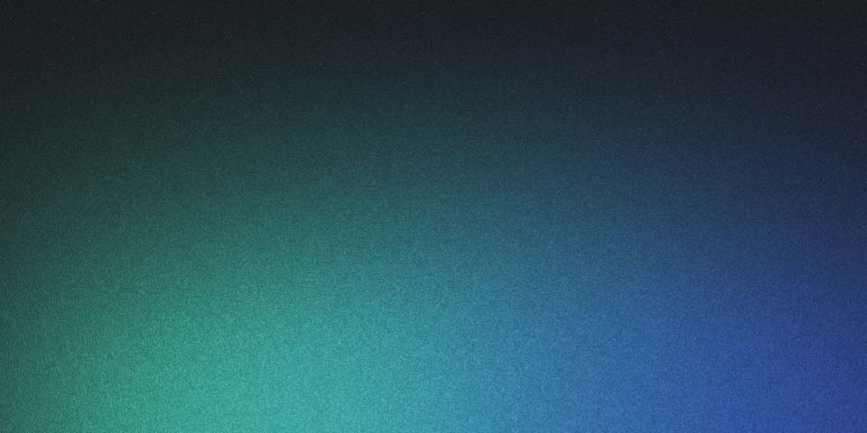

import { Aside } from 'astro-pure/user';

## Un composant dans le texte

<Aside title="Contenu de démonstration">
Cette page vérifie la base technique. Elle ne décrit ni un projet réel ni les conclusions de l’auteur.
</Aside>

## Une équation

Une expression en ligne : $a^2 + b^2 = c^2$.

$$
f(x) = \frac{1}{1 + e^{-x}}
$$

Cette formule est un exemple de rendu, sans interprétation scientifique.

## Une image et sa légende

*Figure de démonstration : image déjà présente dans le projet, à remplacer par les illustrations personnelles.*

## Une note de lecture

Le sommaire permet de revenir aux différentes sections.[^demo]

[^demo]: Note fictive destinée à tester les liens aller-retour dans le texte.
